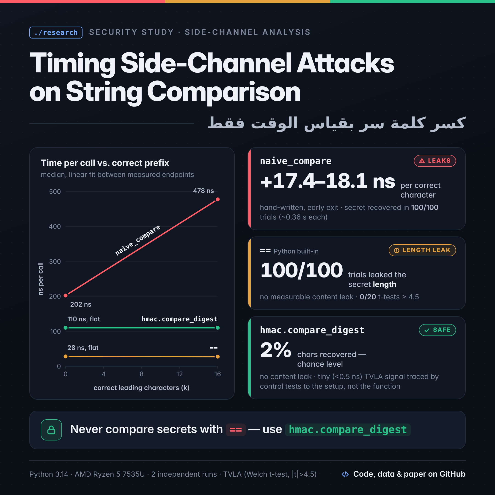
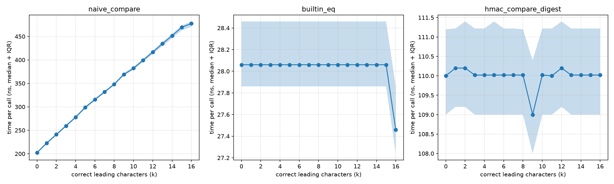
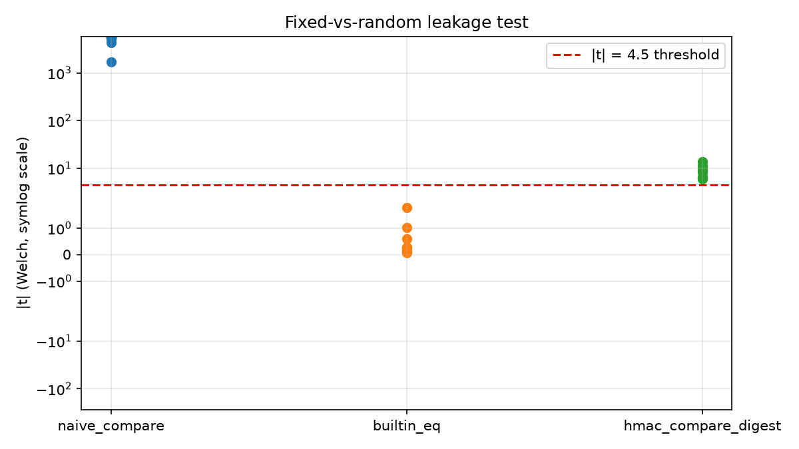

<div align="center">

# Timing Side-Channel Leakage in String Comparison

**A practical, reproducible replication in Python: how a hand-written string comparison leaks a secret one character at a time, and how `hmac.compare_digest` stops it.**

[](https://www.python.org/)
[](LICENSE)
[](paper/paper.pdf)

[Paper (PDF)](paper/paper.pdf) · [Paper (Markdown)](paper/paper.md) · [Key results](#key-results) · [Reproduce](#reproduce-the-experiments) · [Cite](#how-to-cite)

</div>

---

<div dir="rtl">

### ملخص بالعربية

هذا المشروع دراسة تعليمية قابلة لإعادة الإنتاج لهجمات القنوات الجانبية الزمنية (Timing Side-Channel) على دوال مقارنة النصوص في بايثون. نقارن ثلاث دوال: مقارنة يدوية حرفاً بحرف تتوقف عند أول خطأ، والعامل المدمج `==`، والدالة `hmac.compare_digest` المصممة لتأخذ وقتاً ثابتاً، عبر أربع تجارب: قياس التسرّب الزمني، واختبار TVLA (Welch's t-test)، وهجوم كامل يستعيد السر حرفاً حرفاً، واختبارات ضبط (Control). النتيجة: الدالة اليدوية تسرّب نحو 17–18 نانوثانية لكل حرف صحيح، واستعاد الهجوم السر كاملاً في 100 من 100 محاولة، بينما لم يستعد أي معلومة عن محتوى السر من `hmac.compare_digest`. الهدف الوحيد دالة تجريبية محلية على جهاز الباحث، ولا يُستهدف أي نظام حقيقي.

</div>

---


<p align="center"></p>

## What is a timing side channel?

A program can leak a secret not through its output but through **how long it takes** to produce it. A comparison that returns `False` at the *first wrong character* runs a little longer for every correct leading character. An attacker who can time it can recover the secret **one character at a time** (about A × L measurement groups for an alphabet of size A and length L) instead of trying all A^L possible secrets. This weakness class is [CWE-208: Observable Timing Discrepancy](https://cwe.mitre.org/data/definitions/208.html).

This repository is a **replication and educational study** of that classic problem, not a new attack.

## Key results

All experiments were run **twice** on one laptop (HP 255 G10, AMD Ryzen 5 7535U, Arch Linux, Python 3.14.9, `performance` governor, on the charger). Numbers are taken from Tables 1–4 of the [paper](paper/paper.md).

| | `naive_compare` (hand-written loop) | `builtin_eq` (`==`) | `hmac_compare_digest` |
|---|---|---|---|
| **Exp. 1** slope, ns per correct char (run 1 / run 2) | **17.39 / 18.11** | −0.01 / −0.00 | −0.01 / 0.00 |
| **Exp. 1** median at k=0 → k=16, run 1 (ns) | 202.38 → 477.69 | 28.06 → 27.46 | 110.00 → 110.02 |
| **Exp. 2** TVLA repeats with \|t\| > 4.5 (run 1 / run 2) | 10/10 / 10/10 | 0/10 / 0/10 | 10/10 / 8/10 |
| **Exp. 2** t range (both runs) | 1,713.8 to 5,578.9 | −1.77 to 2.32 | 2.23 to 13.97 |
| **Exp. 2** median diff, fixed − random (ns) | 255.08 to 288.74 | 0.00 to 0.02 | 0.0 to 0.4 |
| **Exp. 3** full secret recovered (run 1 / run 2) | **50/50 / 50/50** | 0/50 / 0/50 | 0/50 / 0/50 |
| **Exp. 3** length found (run 1 / run 2) | 50/50 / 50/50 | **50/50 / 50/50** | 0/50 / 0/50 |
| **Exp. 3** characters correct (run 1 / run 2) | 100.00% / 100.00% | 2.25% / 3.25% | 2.00% / 2.00% |
| **Exp. 3** mean time per secret (run 1 / run 2) | 0.370 s / 0.350 s | 0.081 s / 0.096 s | 0.263 s / 0.374 s |
| **Exp. 4** C1 random vs random, repeats with \|t\| > 4.5 (run 1 / run 2) | not run | 0/10 / 0/10 | 0/10 / 0/10 |
| **Exp. 4** C2 fixed vs random (run 1 / run 2) | not run | 0/10 / 0/10 | **10/10 / 8/10** |
| **Exp. 4** C3 near-match vs far-match (run 1 / run 2) | not run | 0/10 / 0/10 | 0/10 / 0/10 |

Random guessing recovers about 1/36 ≈ 3% of characters. Experiment 4 (control tests) was run only on `builtin_eq` and `hmac_compare_digest`.

**In short:**

- The **hand-written comparison leaks clearly**: about 17.4–18.1 ns per correct character, flagged in every t-test, and the attack recovered every 8-character secret (about 1.34 million timed calls and about 0.36 s per secret).
- The **built-in `==`** showed no measurable *content* leak at this resolution, but it **leaked the secret's length** in all 100 trials, and it is not designed to be constant-time.
- **`hmac.compare_digest`** leaked no content. Its small fixed-vs-random TVLA signal (at most 0.4 ns) disappears in the control tests that compare identically built inputs (C1) and a near-match vs a far-match guess (C3), so it comes from how the test inputs were generated, not from the number of matching characters.

### Figures

<p align="center">
  <br>
  <em>Figure 1. Median time per call (ns) against the number of correct leading characters k (run 1). Shaded band: interquartile range.</em>
</p>

<p align="center">
  <br>
  <em>Figure 2. Absolute Welch's t-values for each target and repeat (run 1, symmetric log scale). Red dashed line: |t| = 4.5.</em>
</p>

## The three targets

All three return the same answer to "is `guess` equal to `secret`?" ([`src/targets.py`](src/targets.py)); they differ only in how long they take.

| Target | What it is | Expected behaviour |
|---|---|---|
| `naive_compare` | Hand-written loop; returns `False` at the first mismatch and rejects wrong lengths instantly | Vulnerable |
| `builtin_eq` | `secret == guess` (identity, length and kind checks, then `memcmp` in CPython) | Early exit too, but tiny differences; **not** designed to be constant-time |
| `hmac_compare_digest` | `hmac.compare_digest` on the encoded strings | Constant-time with respect to content (time can still depend on length) |

## Experiments

| # | Script | Question | Method |
|---|---|---|---|
| 1 | [`exp1_leakage.py`](src/exp1_leakage.py) | Does time depend on the number of correct leading characters? | Time a guess with k = 0..L correct leading characters; median + IQR; least-squares slope (ns per correct char) |
| 2 | [`exp2_tvla.py`](src/exp2_tvla.py) | Does a standard leakage test fire? | Fixed-vs-random Welch's t-test (TVLA), same number of samples per class, fresh string object per sample, repeated; \|t\| > 4.5 means "leak detected"; median difference in ns also reported |
| 3 | [`exp3_attack.py`](src/exp3_attack.py) | Can an attacker recover the secret? | Recover the length (10th percentile, slowest guess), then each character (slowest of 36 candidates, adaptive re-measuring), and the last character from the `True`/`False` result |
| 4 | [`exp4_control.py`](src/exp4_control.py) | Does a TVLA result come from the target or from the test setup? | Three control t-tests with identically built inputs: C1 random vs random, C2 fixed vs random, C3 near-match vs far-match |

**Measurement** ([`src/measure.py`](src/measure.py)): all inputs are built before timing starts; one sample is the time of `batch` back-to-back calls divided by `batch` (`time.perf_counter_ns`); guesses are measured in a random interleaved order so slow drift does not look like a signal; and the garbage collector is paused during measurement.

## Reproduce the experiments

Requirements: Linux (tested on Arch Linux), Python 3 (the paper used 3.14.9), NumPy and Matplotlib.

### 1. Set up

```bash
git clone https://github.com/Malminhli/timing-side-channel.git
cd timing-side-channel

python -m venv .venv
source .venv/bin/activate
pip install -r requirements.txt
```

On Arch Linux, install Python first with `sudo pacman -S --needed python git`; the system Python is "externally managed", so always use the virtual environment.

### 2. Sanity run (fast, results not meaningful)

```bash
python src/run_all.py --quick --out results_quick
```

Runs Experiments 1–3 with tiny settings (`QUICK` in [`src/run_all.py`](src/run_all.py)) to check that everything works (under a minute). Do **not** use quick-run numbers for conclusions. Plain `python src/run_all.py --quick` also works, but it writes to `results/` and would overwrite the published results, so keep `--out results_quick` (ignored by git).

### 3. Full run (Experiments 1–3)

```bash
mkdir -p results
python src/run_all.py --out results 2>&1 | tee results/log.txt
```

`run_all.py` writes `results/machine.txt` (Python/NumPy versions, platform, CPU governor, run arguments, full `lscpu`), then runs Experiments 1–3 with each script's own defaults (the paper settings). On the author's laptop one full run took 3.6–3.7 minutes. Keep the `tee` log: the Experiment 1 slopes and the Experiment 3 summary are only printed to the console.

`run_all.py` accepts only `--quick` and `--out DIR` (default: `results/` at the repository root). On a machine without a display, prefix the commands with `MPLBACKEND=Agg`.

### 4. Control tests (Experiment 4)

```bash
python src/exp4_control.py --out results 2>&1 | tee results/log_exp4.txt
```

### Running one experiment with other settings

Run the script directly **from the repository root** (each script's `--out` defaults to `results` relative to the current folder):

```bash
python src/exp2_tvla.py --samples 5000 --out results
python src/exp3_attack.py --trials 10 --out results
```

| Script | Defaults used in the paper |
|---|---|
| `exp1_leakage.py` | `--length 16 --samples 10000 --batch 50 --seed 1` (samples per guess) |
| `exp2_tvla.py` | `--length 16 --samples 200000 --batch 50 --repeats 10 --seed 2` (samples per class) |
| `exp3_attack.py` | `--length 8 --max-len 16 --samples 100 --batch 50 --trials 50 --seed 3` (samples per candidate; margin 1.5, up to 3 rounds) |
| `exp4_control.py` | `--length 16 --samples 200000 --batch 50 --repeats 10 --seed 4 --targets builtin_eq,hmac_compare_digest` |

### Tips for cleaner measurements

Timing is very sensitive to everything else on the machine.

- **Plug in the charger**, close the browser and other heavy programs (and anything that syncs, updates or indexes files), and do not use the laptop during the run.
- **Keep it cool** on a hard, flat surface so it does not throttle.
- **Optional: set the CPU governor to `performance`** to reduce frequency changes. Remember the current value first so you can restore it:

  ```bash
  # 0. remember the current governor (often "powersave")
  ORIG=$(cat /sys/devices/system/cpu/cpu0/cpufreq/scaling_governor); echo "$ORIG"
  cat /sys/devices/system/cpu/cpu*/cpufreq/scaling_governor | sort | uniq -c

  # A. with cpupower (Arch: sudo pacman -S --needed cpupower)
  sudo cpupower frequency-set -g performance

  # B. or directly through sysfs
  echo performance | sudo tee /sys/devices/system/cpu/cpu*/cpufreq/scaling_governor
  ```

  **Restore it afterwards** (same shell, or type the value you noted instead of `$ORIG`):

  ```bash
  sudo cpupower frequency-set -g "$ORIG"
  # or
  echo "$ORIG" | sudo tee /sys/devices/system/cpu/cpu*/cpufreq/scaling_governor
  ```

- Write down what you did (charger, governor, closed programs). The governor at the start of the run is also saved in `results/machine.txt`.

### Outputs

| File | Content |
|---|---|
| `machine.txt` | Python and NumPy versions, platform, processor, CPU governor, run arguments, full `lscpu` output |
| `exp1_leakage.csv` / `.png` | `target, k, median_ns, q1_ns, q3_ns`; three panels of median time vs. k with IQR band |
| `exp2_tvla.csv` / `.png` | `target, repeat, t_value, median_diff_ns, leak`; \|t\| per target and repeat (symlog), red line at 4.5 |
| `exp3_attack.csv` | `target, trial, secret, recovered, length_found, length_ok, chars_correct, length, success, queries, seconds` |
| `exp4_control.csv` | `target, test, repeat, t_value, median_diff_ns, leak` |
| `log.txt`, `log_exp4.txt` | Console output (if saved with `tee` as above) |

### Build the paper PDF

```bash
./paper/build_pdf.sh
```

Needs `pandoc` and `xelatex` (TeX Live). It builds `paper/paper.pdf` from `paper/paper.md` and includes the figures from `results/`; if a figure is missing, a placeholder box is printed instead.

## Repository layout

```
timing-side-channel/
├── src/
│   ├── targets.py          the three comparison functions
│   ├── measure.py          batching, interleaving, GC pause, Welch's t
│   ├── exp1_leakage.py     Experiment 1: leakage characterisation
│   ├── exp2_tvla.py        Experiment 2: fixed-vs-random TVLA
│   ├── exp3_attack.py      Experiment 3: end-to-end secret recovery
│   ├── exp4_control.py     Experiment 4: control tests
│   └── run_all.py          runs Experiments 1-3 and saves machine info
├── results/                run 1: CSVs, figures, logs, machine.txt
├── results_run2/           run 2 (repeatability check)
├── paper/
│   ├── paper.md            the paper (source)
│   ├── paper.pdf           the paper (built with build_pdf.sh)
│   ├── build_pdf.sh        pandoc + xelatex build script
│   ├── latex/              LaTeX header and pandoc Lua filter for the PDF
│   ├── references.md       annotated, checked reference list
│   └── template/           original paper template with placeholders
├── PROMPT_FOR_CLAUDE_CODE.md   instructions used to run the experiments
├── requirements.txt
├── CITATION.cff
└── LICENSE
```

## Ethics and scope

- The only target is a **local toy function** in this repository. Secrets are random strings generated by the experiment code on the author's own laptop.
- The attacker model is **in-process on one machine**: the attacker calls the function and times it directly. **Remote and network attacks are out of scope**; results are an upper bound for a Python-level attacker on this machine, not a statement about real services.
- Do not use these techniques against any system you do not own or do not have written permission to test.
- **Takeaway for developers:** compare secrets with `hmac.compare_digest` / `secrets.compare_digest`, never `==` or a hand-written loop, and compare fixed-length values (for example an HMAC of the secret) to hide the length.

## How to cite

If you use this code or the results, please cite the paper. GitHub's **"Cite this repository"** button uses [`CITATION.cff`](CITATION.cff).

```bibtex
@misc{alminhali2026timing,
  author       = {Alminhali, Mohammed Saeed},
  title        = {Measuring Timing Side-Channel Leakage in String Comparison:
                  A Practical Replication in Python},
  year         = {2026},
  month        = nov,
  note         = {Preprint},
  howpublished = {\url{https://github.com/Malminhli/timing-side-channel}}
}
```

## Further reading

Kocher (1996) on timing attacks; Brumley & Boneh (2003) on remote timing attacks; Crosby et al. (2009) on measuring small time differences; Goodwill et al. (2011) on TVLA; Schneider & Moradi (2015) on leakage assessment; the Python [`hmac.compare_digest`](https://docs.python.org/3/library/hmac.html#hmac.compare_digest) documentation. Full references are in the [paper](paper/paper.md#references).

## License

Released under the [MIT License](LICENSE).

---

<p align="center"><strong>Mohammed Saeed Alminhali</strong> · 2026</p>
