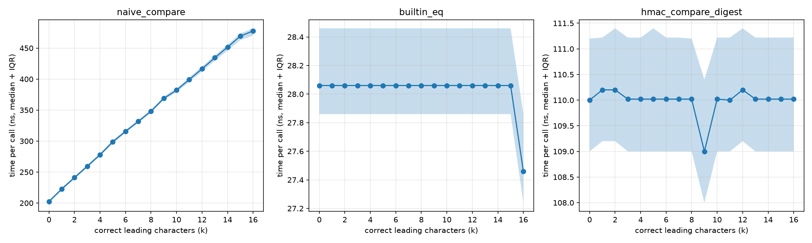
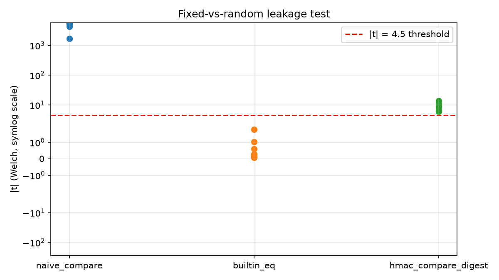

# Measuring Timing Side-Channel Leakage in String Comparison: A Practical Replication in Python

**Mohammed Saeed Alminhali**
November 2026

---

## Abstract

Timing side-channel attacks recover secret information by measuring how long a program takes to run. A classic example is a function that compares a secret (such as a password or an authentication token) with a guess and stops at the first wrong character. This paper is a practical, educational replication of this well-known problem; it does not claim a new attack. We study three comparison functions in Python: a hand-written character-by-character comparison with early exit, Python's built-in `==` operator, and `hmac.compare_digest`, which is designed to run in constant time. All experiments were run twice on one laptop (AMD Ryzen 5 7535U, Arch Linux, Python 3.14.9). The hand-written function leaks about 17.4–18.1 ns per correct leading character, is flagged by a fixed-vs-random Welch's t-test (TVLA) with |t| up to 5,579, and an end-to-end attack recovered the full 8-character secret in 100 of 100 trials, in about 0.36 s per secret. The built-in `==` showed no measurable content leak (flat timing, |t| < 4.5 in all 20 tests, character recovery at chance level), but it revealed the secret's length in 100 of 100 trials. For `hmac.compare_digest`, the attack recovered no information about the content. The standard fixed-vs-random test did cross the 4.5 threshold, with differences below 0.5 ns. A follow-up control experiment showed no difference between identically built random inputs and no difference between a near-match and a far-match guess, which indicates that this result comes from how the test inputs were generated and not from the content of the comparison. We discuss these results, the limits of the method, and how to avoid the problem.

**Keywords:** side-channel attacks, timing attacks, constant-time comparison, TVLA, Welch's t-test, Python

---

## 1 Introduction

A *side channel* is any observable effect of a computation that is not part of its normal output but still carries information about the data being processed. Examples are running time, power consumption, electromagnetic emissions, and cache behaviour. If this information depends on a secret, an attacker who can observe it may learn the secret without breaking the underlying algorithm.

Timing is the easiest side channel to observe, because an attacker often only needs a clock. Kocher showed in 1996 that the running time of cryptographic operations can leak private keys [1]. Later, Brumley and Boneh showed that timing attacks also work against real software (OpenSSL) over a network [2], and Crosby et al. studied how precisely an attacker can measure small time differences by collecting many samples and filtering them [3].

**Why comparison functions matter.** Many security checks end with a comparison: "is the submitted password, token, API key, or MAC equal to the stored one?" The simplest way to compare two strings is to check them character by character and return `False` at the first difference. This is correct, but its running time depends on *how many leading characters are correct*. An attacker who can measure this time can guess the secret one character at a time. Instead of trying all possible secrets (A^L guesses for an alphabet of size A and length L), the attacker needs only about A × L groups of measurements. This weakness class is catalogued as CWE-208, "Observable Timing Discrepancy" [8], and it still appears in real software: for example, Apache Tapestry compared form HMACs with `String.equals()` (CVE-2019-10071) [9], and a 2026 Node.js advisory describes HMAC verification that leaked timing proportional to the number of matching bytes (CVE-2026-21713) [10].

**Contribution.** This is a replication and educational study. Our goals are to:

1. measure the timing leakage of three comparison functions in Python on a normal laptop;
2. apply a standard leakage detection test (TVLA, Welch's t-test) to them;
3. run a simple end-to-end attack and report how often it succeeds and how many queries it needs;
4. check an unexpected TVLA result with control experiments;
5. release all code so that others can repeat the experiments on their own machines.

Section 2 gives background, Section 3 defines the threat model, Section 4 describes the method, and Section 5 presents the results. Section 6 discusses them and their limits, Section 7 lists mitigations, and Section 8 concludes.

---

## 2 Background

### 2.1 Timing attacks

A timing attack has two parts: (1) a *leak*, meaning the running time depends on secret data, and (2) a *measurement*, meaning the attacker can observe that time with enough precision. Real measurements are noisy: the operating system, other programs, CPU frequency changes, caches, and (in Python) the interpreter itself all add delay. The attacker fights this noise by repeating each measurement many times and using robust statistics such as the median or a low percentile [3].

### 2.2 Leakage detection with TVLA (Welch's t-test)

Test Vector Leakage Assessment (TVLA) checks *whether* a device or program leaks, without building a full attack [4]. In the common *fixed-vs-random* version, we collect two sets of measurements:

- **fixed class:** the same chosen input every time;
- **random class:** a new random input every time.

Then we compute Welch's t-statistic between the two sets:

$$ t = \frac{\bar{X}_F - \bar{X}_R}{\sqrt{\dfrac{s_F^2}{n_F} + \dfrac{s_R^2}{n_R}}} $$

where $\bar{X}$ is the mean, $s^2$ is the sample variance, and $n$ is the number of samples in each class. If the program does not leak, |t| should stay small. The usual rule is: if |t| > 4.5, we conclude that there is leakage [4, 5]. Schneider and Moradi discuss this method in detail, including its statistical assumptions and the difference between non-specific (fixed-vs-random) and specific tests [5].

Two points are important. First, TVLA tests for a *difference*, not for exploitability: a difference can be detected but still be too small to use in an attack. Second, a fixed-vs-random test says that the two classes differ, but not *why*; any systematic difference between the classes, including one caused by the test setup, can make |t| large when the number of samples is large.

### 2.3 Constant-time comparison

A *constant-time* comparison takes the same time no matter where the first difference is. The usual technique is to look at every byte, combine the differences with bitwise operations, and check the combined result only at the end, without early exit and without branches that depend on the secret [7]. Python provides this as `hmac.compare_digest` (also available as `secrets.compare_digest`) [6]. The documentation notes one limitation: if the two inputs have different lengths, a timing attack could in theory reveal their types and lengths, but not their values [6].

---

## 3 Threat Model

- **Capability:** the attacker can call a function `check(guess)` as many times as they want. It compares `guess` with a fixed secret and returns `True` or `False`.
- **Observation:** the attacker measures the running time of each call with `time.perf_counter_ns` *in the same process*, on the same machine.
- **Knowledge:** the attacker knows the alphabet (lowercase letters and digits, 36 characters) and an upper bound on the length, but not the secret or its exact length.
- **Goal:** recover the full secret.

This is close to the best case for the attacker, because there is no network delay. **Remote attacks over a network are out of scope.** A network adds much more noise, so a leak that is hard to use locally is usually even harder to use remotely [2, 3]. Our results should be read as an upper bound on what a Python-level attacker can do on this machine, not as a statement about real web services.

---

## 4 Methodology

All code is written in Python and is available in the project repository (see *Code availability*). Experiments 1–3 were run with `src/run_all.py`, which also saves the machine details to `results/machine.txt`; Experiment 4 was run with `src/exp4_control.py`. Every experiment was run **twice** (run 1 and run 2) to check that the results are stable.

### 4.1 Experimental setup

| Item | Value |
|---|---|
| Laptop | HP 255 G10 |
| CPU | AMD Ryzen 5 7535U with Radeon Graphics (12 threads) |
| Operating system | Arch Linux |
| Python | 3.14.9 (NumPy 2.5.5, Matplotlib 3.11.2) |
| CPU frequency governor | `performance` on all 12 CPUs (amd-pstate-epp driver) |
| Power | charger connected, battery full |
| Other programs | browser, media player, file manager and software-update app closed |
| Duration of one full run (Exp. 1–3) | 3.6 min (run 1), 3.7 min (run 2) |

### 4.2 Targets

All three targets answer the same question, "is `guess` equal to `secret`?" (`src/targets.py`):

1. **`naive_compare`** (vulnerable). It returns `False` if the lengths differ. Then it compares the strings character by character in a Python loop and returns `False` at the first mismatch.
2. **`builtin_eq`**. Python's built-in `secret == guess`. In CPython, string equality checks whether both are the same object, then the length, then the internal character width, and finally the raw memory with C `memcmp`, which may also stop early. It is fast C code and is *not* documented as constant-time.
3. **`hmac_compare_digest`** (constant-time reference). It converts both strings to bytes with `.encode()` and calls `hmac.compare_digest` [6]. Its time can still depend on the *length* of the guess.

### 4.3 Measurement procedure

- **Inputs built before timing.** All guesses are created before the timed loop starts, so only the target function runs inside the timed region.
- **Batching.** One *sample* is the total time of 50 back-to-back calls with the same input, divided by 50. Every sample also includes the cost of the Python function call and loop, so absolute values are larger than the comparison itself; only *differences* between inputs matter.
- **Interleaving.** All (guess, sample) pairs are shuffled into one random order, so slow drift (for example, CPU frequency changes) is spread evenly over all guesses.
- **Garbage collector disabled** during measurement.

The clock moves in steps of about 10 ns, so with a batch of 50 a sample can only take values about 0.2 ns apart. This limits how small a difference can be seen in a single sample. All random choices use NumPy's random generator with fixed seeds.

### 4.4 Experiment 1: Leakage characterisation

*Does the time depend on the number of correct leading characters?*

We generate a random secret of length L = 16. For each k = 0, …, 16 we build a guess whose first k characters are correct and whose other characters are wrong. All guesses have the correct length, and each is a new string object (CPython's `==` first checks whether both sides are the same object; reusing the secret object would make `builtin_eq` look artificially fast at k = L). Each guess gets 10,000 interleaved samples (batch 50, seed 1). We plot the median time against k and fit a straight line to the medians to get the slope in ns per correct character.

### 4.5 Experiment 2: Leakage detection (TVLA)

*Does a standard statistical test detect leakage?*

The **fixed** guess is the secret (length 16) with only the *last* character changed, so it matches 15 leading characters. The **random** class uses a new random guess for every sample. Each test uses 200,000 samples per class in random order (batch 50) and is repeated 10 times per target (seed 2). The fixed class gets a fresh copy of the fixed guess (same content, new object) for every sample. Because |t| grows with the square root of the sample size for any real difference, we also report the difference in medians (fixed − random) in nanoseconds.

### 4.6 Experiment 3: End-to-end secret recovery

*Can an attacker who only calls `check(guess)` and measures time recover the secret?*

For each target we run 50 trials, each with a new random 8-character secret (seed 3). The attack (`src/exp3_attack.py`) has three steps:

1. **Recover the length.** Time the guesses `a`, `aa`, …, up to 16 characters, and pick the slowest. The time estimate for each guess is the **10th percentile** of its samples, not the median, because timing samples are often bimodal and a low percentile follows the undisturbed time more stably (the "box test" idea of Crosby et al. [3]).
2. **Recover the characters one position at a time.** Try all 36 candidates `known + c + padding` (`#` padding, which never matches), 100 interleaved samples each (batch 50), and keep the slowest. If the gap between the best and second-best estimate is not larger than 1.5 times the median absolute deviation of all 36 estimates, measure again and *add* the new samples, up to 3 rounds.
3. **Recover the last character** with the `True`/`False` result, because the last position gives no timing signal.

If step 1 fails, steps 2 and 3 still run with the *true* length, so the character stage can be judged on its own; such a trial never counts as a success. Random guessing would get about 1/36 ≈ 3% of characters right. Each timed call counts as one query.

### 4.7 Experiment 4: Control tests for the TVLA result

Experiment 2 flagged `hmac_compare_digest` with a very small difference (Section 5.2). A fixed-vs-random test cannot tell whether such a difference comes from the target or from the test setup, so we added three control tests (`src/exp4_control.py`). In all of them, every input goes through the same final step (`"".join(list(s))`, a fresh object per sample), all inputs are built before timing, and the classes are shuffled. Settings: secret length 16, 200,000 samples per class, batch 50, 10 repeats, seed 4; targets `builtin_eq` and `hmac_compare_digest`.

- **C1 – random vs random:** both classes are random guesses. Nothing differs, so any "leak" here would mean the harness itself is biased.
- **C2 – fixed vs random:** the near-match guess vs random guesses, as in Experiment 2.
- **C3 – fixed vs fixed:** a near-match guess (last character wrong, 15 matching characters) vs a far-match guess (first character wrong, 0 matching characters). Both classes repeat one content, so the inputs are equally "diverse"; only the number of matching characters differs. This is the test that directly targets the leak we care about.

One limitation of C2 remains: each random guess is produced through an extra NumPy array and a temporary string before the final copy, while the fixed guess is not. So in C2, "repeated vs varied content" cannot be separated from these extra memory allocations. C1 and C3 do not have this problem.

---

## 5 Results

### 5.1 Experiment 1: Leakage characterisation

**Figure 1.** Median time per call (ns) against the number of correct leading characters k (run 1). Shaded band: interquartile range.

| Target | Slope (ns/char), run 1 | Median k=0 / k=16 (ns), run 1 | Slope (ns/char), run 2 | Median k=0 / k=16 (ns), run 2 |
|---|---|---|---|---|
| `naive_compare` | 17.39 | 202.38 / 477.69 | 18.11 | 206.38 / 490.72 |
| `builtin_eq` | −0.01 | 28.06 / 27.46 | −0.00 | 27.26 / 27.04 |
| `hmac_compare_digest` | −0.01 | 110.00 / 110.02 | 0.00 | 108.42 / 108.42 |

**Table 1.** Results of Experiment 1. The slope is a least-squares line fitted to the medians.

The hand-written comparison shows a clear, almost linear increase: each correct character adds about 17–18 ns, and a fully correct guess takes more than twice as long as a guess that is wrong at the first character. The two runs agree within about 4%. The built-in `==` and `hmac.compare_digest` are flat: their slopes are 0.01 ns per character or less, and their medians at k = 0 and k = 16 differ by less than 1 ns.

### 5.2 Experiment 2: Leakage detection (TVLA)

**Figure 2.** Absolute Welch's t-values for each target and repeat (run 1, symmetric log scale). Red dashed line: |t| = 4.5.

| Target | Repeats with \|t\| > 4.5 (run 1 / run 2) | t range (both runs) | Median diff, fixed − random (ns) |
|---|---|---|---|
| `naive_compare` | 10/10 / 10/10 | 1,713.8 to 5,578.9 | 255.08 to 288.74 |
| `builtin_eq` | 0/10 / 0/10 | −1.77 to 2.32 | 0.00 to 0.02 |
| `hmac_compare_digest` | 10/10 / 8/10 | 2.23 to 13.97 | 0.0 to 0.4 |

**Table 2.** Results of Experiment 2 (200,000 samples per class, 10 repeats per run). Full values: `results/exp2_tvla.csv`.

The hand-written comparison is flagged in every repeat with very large t-values. Its median difference of about 255–289 ns fits Experiment 1: the fixed guess matches 15 characters, and 15 × ~17.4 ns ≈ 261 ns. The built-in `==` is never flagged. The constant-time function is flagged in 18 of 20 repeats, although the median difference is at most 0.4 ns, about two steps of the measurement resolution. All 20 of its t-values were positive (fixed class slower). Experiment 4 checks where this comes from.

### 5.3 Experiment 3: End-to-end secret recovery

| Target | Run | Length found | Success | Chars correct | Median queries | Mean time (s) |
|---|---|---|---|---|---|---|
| `naive_compare` | 1 | 50/50 | 50/50 | 100.00% | 1,340,021.5 | 0.370 |
| `naive_compare` | 2 | 50/50 | 50/50 | 100.00% | 1,340,021.5 | 0.350 |
| `builtin_eq` | 1 | 50/50 | 0/50 | 2.25% | 2,420,036.0 | 0.081 |
| `builtin_eq` | 2 | 50/50 | 0/50 | 3.25% | 2,780,036.0 | 0.096 |
| `hmac_compare_digest` | 1 | 0/50 | 0/50 | 2.00% | 1,970,036.0 | 0.263 |
| `hmac_compare_digest` | 2 | 0/50 | 0/50 | 2.00% | 3,050,036.0 | 0.374 |

**Table 3.** Results of Experiment 3 (50 trials per target and run, 8-character secrets). "Chars correct" is the share of characters recovered in the correct position; random guessing gives about 3%. Median queries and mean time were calculated from `results/exp3_attack.csv`.

Against the hand-written comparison, the attack recovered the length and the full secret in all 100 trials, using about 1.34 million timed calls and about 0.36 s per secret. For comparison, brute force over all 8-character secrets from a 36-character alphabet needs up to 36^8 ≈ 2.8 × 10^12 guesses. The higher number of queries for the other two targets comes from the adaptive step: when no candidate stands out, the attack measures again.

Against the built-in `==`, the attack found the correct **length** in all 100 trials, because a wrong length returns before the content is compared. The characters, however, stayed at chance level (2.25% and 3.25%), so no secret was recovered. Against `hmac.compare_digest`, the length step always chose a wrong length (13, 14 or 15 characters), and the characters stayed at chance level (2.00% in both runs).

The secrets in Experiment 3 are drawn from the same random generator that the adaptive retries use, so only the first 51 of the 150 secrets per run are identical between the two runs. This explains why the query counts for `builtin_eq` and `hmac_compare_digest` differ between runs; the success rates and character rates are what should be compared.

### 5.4 Experiment 4: Control tests

| Target | Test | Repeats with \|t\| > 4.5 (run 1 / run 2) | t range, run 1 | t range, run 2 | Median diff (ns), run 1 / run 2 |
|---|---|---|---|---|---|
| `builtin_eq` | C1 random vs random | 0/10 / 0/10 | −2.05 to 1.37 | −2.38 to 1.44 | 0.0 / 0.0 |
| `builtin_eq` | C2 fixed vs random | 0/10 / 0/10 | −2.52 to −0.53 | −3.39 to 1.28 | 0.0 / −0.02 to 0.0 |
| `builtin_eq` | C3 fixed vs fixed | 0/10 / 0/10 | −1.63 to 1.97 | −2.47 to 2.50 | 0.0 / −0.02 to 0.0 |
| `hmac_compare_digest` | C1 random vs random | 0/10 / 0/10 | −1.98 to 1.57 | −1.81 to 1.40 | 0.0 to 0.02 / 0.0 |
| `hmac_compare_digest` | C2 fixed vs random | **10/10 / 8/10** | −14.95 to −6.32 | −13.75 to −1.91 | −0.6 to −0.02 / −0.22 to 0.0 |
| `hmac_compare_digest` | C3 fixed vs fixed | 0/10 / 0/10 | −1.37 to 1.70 | −1.00 to 1.95 | 0.0 / −0.18 to 0.0 |

**Table 4.** Results of Experiment 4 (200,000 samples per class, 10 repeats per run). Full values: `results/exp4_control.csv`.

Both runs give the same picture. For `hmac.compare_digest`, the harness is unbiased (C1 clean), and the number of matching characters has no detectable effect on time (C3 clean, 0 of 20 repeats). Only the fixed-vs-random test (C2) crosses the threshold. The sign of t also **flipped** compared with Experiment 2: in Experiment 2 the fixed guess was slower in all 20 repeats, while in Experiment 4 C2 it was faster in all 20 repeats. Two things changed between the experiments (an extra copy step for the random guesses, and a different secret, seed 2 vs seed 4), and our data cannot tell which one caused the flip. The built-in `==` was clean in all six tests.

---

## 6 Discussion

### 6.1 The hand-written comparison leaks clearly

The hand-written `naive_compare` runs a Python loop, and each extra correct character costs one more loop step in the interpreter, about 17–18 ns on our machine. This is roughly 90 times larger than the ~0.2 ns sample resolution and was large enough for every method we used: it is visible in Figure 1, detected in every t-test, and the attack recovered every secret in well under a second. This is the classic result of the literature [1–3], reproduced on an ordinary laptop with a few hundred lines of Python.

### 6.2 The built-in `==`: no content leak measured, but the length leaks

Python's `==` for strings is also an early-exit comparison in principle: it checks the length and then calls `memcmp`, which may stop at the first difference. In our measurements this did not produce a usable signal. The slope was at most 0.01 ns per character, the t-test was never above 4.5 (0 of 20 repeats in Experiment 2 and 0 of 60 in Experiment 4), and character recovery stayed at chance level. A likely reason is that `memcmp` compares many bytes per CPU instruction, so for a 16-character string the position of the first difference changes the time by much less than our ~0.2 ns resolution, while every sample also contains the much larger cost of a Python function call.

However, "not measured here" does not mean "safe". First, the **length leaked completely**: the attack found the correct length in 100 of 100 trials, because a wrong length returns before the content is compared. Second, `==` is **not designed or documented to be constant-time**. Longer secrets, native code, a more precise clock, or another platform could make the content leak measurable. Security code should therefore never rely on `==` to compare secrets.

### 6.3 The constant-time function, and what the TVLA result means

For `hmac.compare_digest`, the attack recovered no information about the content (2.00% of characters in both runs, close to the ~3% expected from random guessing), and Experiment 1 showed a flat line. The fixed-vs-random t-test, however, flagged it in 18 of 20 repeats with differences of at most 0.4 ns.

The control experiment explains most of this. The direct test of the leak we care about, a near-match vs a far-match guess built in exactly the same way (C3), was clean in all 20 repeats. Comparing two classes of random guesses built the same way (C1) was also clean, so the harness itself is not biased. The difference appears only when one class repeats one fixed content and the other class uses varied, randomly generated content (C2), and its sign changed between Experiment 2 and Experiment 4. Together this indicates that the small difference is caused by **how the test inputs are produced** (repeated vs varied data, and the extra memory allocations needed to generate random guesses), not by the number of matching characters. Because of the C2 limitation described in Section 4.7, we cannot say which of these two causes it is.

This is a useful lesson about the method itself: with hundreds of thousands of samples, a non-specific fixed-vs-random test is sensitive enough to detect sub-nanosecond differences that have nothing to do with the secret. A significant |t| should therefore be followed by control tests and by specific tests that isolate the suspected leak [5], and the size of the difference should always be reported.

Finally, `hmac.compare_digest` only promises to hide the *content*, not the length [6]. In our attack its length step always chose a wrong length (13–15 instead of 8), so the length was not recovered here, but this behaviour depends on the target and should not be relied on.

### 6.4 Limitations

- **Single machine.** All results come from one laptop (AMD Ryzen 5 7535U). Other CPUs, operating systems, and Python versions may give different numbers.
- **In-process, local attacker.** The attacker measures time inside the same Python process. We did not test attacks across processes or over a network.
- **CPU frequency scaling.** We used the `performance` governor, the charger, and interleaving to reduce frequency changes and drift, but we cannot remove them completely.
- **Python interpreter noise and clock resolution.** Function calls, loops, and memory allocation in CPython add delays much larger than the effect of `memcmp`, and our samples have a resolution of about 0.2 ns. This hides very small leaks; it is a property of our method, not proof that no leak exists.
- **The C2 control test** cannot separate repeated-vs-varied content from the extra allocations used to create random guesses (Section 4.7).
- **Limited trials.** Experiment 3 uses 50 trials per target and run, so the success rates are estimates.
- **Short, simple secrets.** We used 8- and 16-character secrets from a 36-character alphabet. Real tokens are often longer.

---

## 7 Mitigations

1. **Use a constant-time comparison for secrets.** In Python, use `hmac.compare_digest(a, b)` or `secrets.compare_digest(a, b)` [6]. Both accept bytes, or `str` values that contain only ASCII characters.
2. **Hide the length.** `compare_digest` may still reveal the length [6], and `==` revealed it in all of our trials. Compare fixed-length values instead, for example an HMAC or cryptographic hash of the secret, so that both inputs always have the same length.
3. **Constant-time coding in general.** Do not let the secret control branches, loop exits, or memory addresses; process all bytes and check the combined result once at the end [7]. In a high-level language like Python, the interpreter does not guarantee constant time, so use a well-tested library function instead of writing your own.
4. **Limit what the attacker can measure.** Rate limiting, account lockout, and authentication before the check reduce the number of queries. The attack on `naive_compare` needed about 1.34 million calls per secret, so strict rate limiting makes it much harder, but it does not fix the leak and should be used *together with* constant-time comparison. Adding random delay is not a reliable fix, because averaging many samples removes it [3].

---

## 8 Conclusion

We repeated a classic timing side-channel experiment on string comparison in Python on an ordinary laptop, and ran every experiment twice. A hand-written comparison with early exit leaked about 17.4–18.1 ns per correct character, was detected by the TVLA t-test in every repeat, and allowed an end-to-end attack to recover the full secret in 100 of 100 trials in about 0.36 s each. Python's built-in `==` showed no measurable content leak at our resolution, but it revealed the secret length in every trial, and it is not designed to be constant-time. `hmac.compare_digest` leaked no content; a small fixed-vs-random TVLA signal was traced by control experiments to the way the test inputs were generated, not to the number of matching characters. The main lessons are simple: compare secrets with a function designed to be constant-time, such as `hmac.compare_digest`, compare fixed-length values to hide the length, and when a leakage test fires, check it with control tests before drawing conclusions. Future work could repeat the experiments on other machines, measure across processes or over a local network, and test longer secrets.

---

## Ethics Statement

All experiments target only a local toy function written for this study. The secrets are random strings generated by the experiment code on the author's own laptop. No real system, service, account, or third-party data was attacked or accessed. The code is released for education and to help developers understand why constant-time comparison is needed.

## Acknowledgements

AI assistants (Claude) were used to help review the experiment code, check references, and edit the English text. All experiments were run, and all results were produced, on the author's own machine.

## Code Availability

All code, raw results, and figures are available at https://github.com/Malminhli/timing-side-channel. Experiments 1–3 can be repeated with `python src/run_all.py` and Experiment 4 with `python src/exp4_control.py`; the machine details of each run are saved in `results/machine.txt`.

---

## References

[1] P. C. Kocher, "Timing attacks on implementations of Diffie-Hellman, RSA, DSS, and other systems," in *Advances in Cryptology – CRYPTO '96*, LNCS vol. 1109. Springer, 1996, pp. 104–113, doi: 10.1007/3-540-68697-5_9.

[2] D. Brumley and D. Boneh, "Remote timing attacks are practical," in *Proc. 12th USENIX Security Symp.*, Washington, DC, USA, Aug. 2003. [Online]. Available: https://www.usenix.org/conference/12th-usenix-security-symposium/remote-timing-attacks-are-practical

[3] S. A. Crosby, D. S. Wallach, and R. H. Riedi, "Opportunities and limits of remote timing attacks," *ACM Trans. Inf. Syst. Secur.*, vol. 12, no. 3, Art. no. 17, Jan. 2009, doi: 10.1145/1455526.1455530.

[4] G. Goodwill, B. Jun, J. Jaffe, and P. Rohatgi, "A testing methodology for side-channel resistance validation," presented at the NIST Non-Invasive Attack Testing Workshop (NIAT 2011), Nara, Japan, Sep. 2011. [Online]. Available: https://csrc.nist.gov/CSRC/media/Events/Non-Invasive-Attack-Testing-Workshop/documents/08_Goodwill.pdf

[5] T. Schneider and A. Moradi, "Leakage assessment methodology," in *Cryptographic Hardware and Embedded Systems – CHES 2015*, LNCS vol. 9293. Springer, 2015, pp. 495–513, doi: 10.1007/978-3-662-48324-4_25.

[6] Python Software Foundation, "hmac — Keyed-hashing for message authentication," *The Python Standard Library*. [Online]. Available: https://docs.python.org/3/library/hmac.html#hmac.compare_digest

[7] J. B. Almeida, M. Barbosa, G. Barthe, F. Dupressoir, and M. Emmi, "Verifying constant-time implementations," in *Proc. 25th USENIX Security Symp.*, Austin, TX, USA, Aug. 2016, pp. 53–70.

[8] The MITRE Corporation, "CWE-208: Observable timing discrepancy." [Online]. Available: https://cwe.mitre.org/data/definitions/208.html

[9] "CVE-2019-10071," National Vulnerability Database, Sep. 2019. [Online]. Available: https://nvd.nist.gov/vuln/detail/CVE-2019-10071

[10] "CVE-2026-21713," Node.js security releases, Mar. 2026. [Online]. Available: https://nodejs.org/en/blog/vulnerability/march-2026-security-releases
