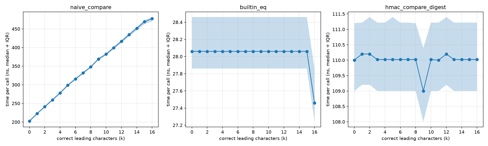
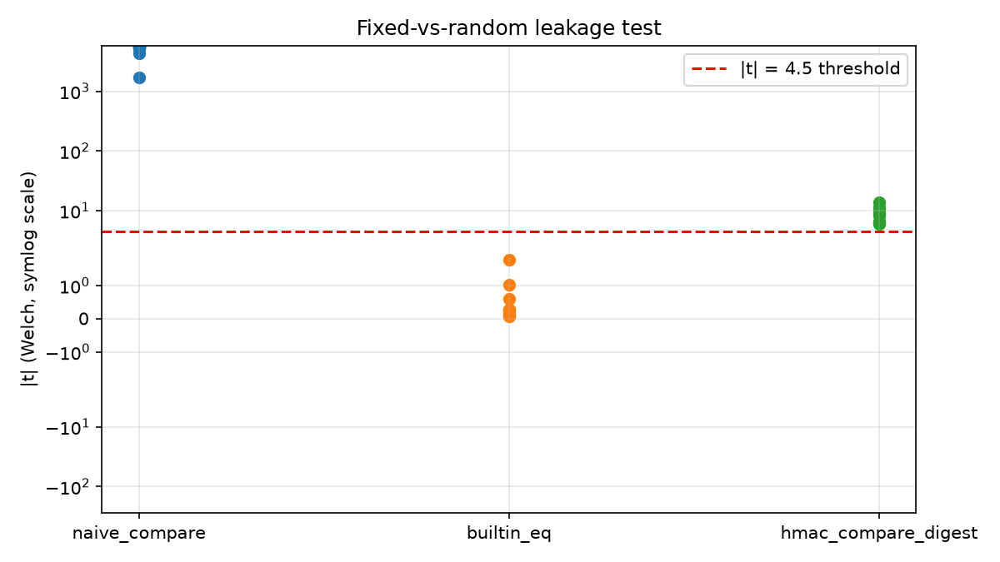

<!--
=====================================================================
PLACEHOLDER GUIDE (delete this comment before submitting)

Every {{...}} below must be replaced with YOUR measured value or info.
Do not keep any number you did not measure yourself.

Where to find each value after running `python src/run_all.py | tee results/log.txt`:

  Machine info ........ results/machine.txt  (Python + NumPy version, platform/kernel,
                        CPU governor, full lscpu output -> CPU model)
  Parameters .......... the full run uses each script's own defaults (argparse
                        add_argument lines in src/exp1_leakage.py, src/exp2_tvla.py,
                        src/exp3_attack.py), unless FULL in src/run_all.py adds flags.
                        Margin and retries: recover_secret() in src/exp3_attack.py.
                        machine.txt also records the args of the run.
                        Check the code before you fill them in, in case it changed.
  Exp 1 slopes ........ console output / results/log.txt  ("slope = ... ns per correct char")
  Exp 1 medians ....... results/exp1_leakage.csv  (columns: target, k, median_ns, q1_ns, q3_ns)
  Exp 2 t-values ...... results/exp2_tvla.csv     (columns: target, repeat, t_value,
                        median_diff_ns, leak)
  Exp 3 numbers ....... results/exp3_attack.csv   (columns: target, trial, secret, recovered,
                        length_found, length_ok, chars_correct, length, success,
                        queries, seconds)
                        and the "[exp3] summary" lines in the console.

Paragraphs marked "AUTHOR CHECK" were written before the results existed.
Read them again after you have your numbers and rewrite them if your
results say something different. The paper must describe what YOU saw.
=====================================================================
-->

# Measuring Timing Side-Channel Leakage in String Comparison: A Practical Replication in Python

**Mohammed Saeed Alminhali**
{{AFFILIATION}}
{{AUTHOR_EMAIL}}
{{DATE}}

---

## Abstract

<!-- AUTHOR CHECK: the abstract and the conclusion assume the naive target leaked and was attacked successfully. Rewrite them if your results differ. -->

Timing side-channel attacks recover secret information by measuring how long a program takes to run. A classic example is a function that compares a secret (for example, a password or an authentication token) with a user's guess and stops at the first wrong character. This paper is a practical, educational replication of this well-known problem; it does not claim a new attack. We study three comparison functions in Python: a hand-written character-by-character comparison with early exit, Python's built-in `==` operator, and `hmac.compare_digest`, which is designed to run in constant time. We run three experiments on a single laptop ({{CPU_MODEL}}, Arch Linux, Python {{PYTHON_VERSION}}). First, we measure how the running time changes with the number of correct leading characters. The hand-written function shows a slope of about {{EXP1_NAIVE_SLOPE_NS}} ns per correct character. Second, we apply a fixed-vs-random Welch's t-test (the TVLA methodology) with the standard threshold |t| > 4.5. Third, we run an end-to-end attack that recovers the secret length and then the secret itself, one character at a time. The attack recovered the full secret from the hand-written function in {{EXP3_NAIVE_SUCCESS_RATE}} trials. {{ABSTRACT_RESULT_SENTENCE_BUILTIN_AND_HMAC}} We discuss why the attack is hard against the built-in `==` from Python at this time resolution, why `==` is still not designed to be constant-time, and how to avoid the problem with `hmac.compare_digest`.

**Keywords:** side-channel attacks, timing attacks, constant-time comparison, TVLA, Welch's t-test, Python

---

## 1 Introduction

A *side channel* is any physical or observable effect of a computation that is not part of its normal output, but still carries information about the data being processed. Examples are running time, power consumption, electromagnetic emissions, and cache behaviour. If this information depends on a secret, an attacker who can observe it may learn the secret without breaking the underlying algorithm.

Timing is the easiest side channel to observe, because an attacker often only needs a clock. Kocher showed in 1996 that the running time of cryptographic operations can leak private keys [1]. Later, Brumley and Boneh showed that timing attacks also work against real software (OpenSSL) over a network [2], and Crosby et al. studied how precisely an attacker can measure small time differences, even across a network, by collecting many samples and filtering them [3].

**Why comparison functions matter.** Many security checks end with a comparison: "is the submitted password, token, API key, or MAC equal to the stored one?" The simplest way to compare two strings is to check them character by character and return `False` at the first difference. This is fast and correct, but its running time depends on *how many leading characters are correct*. An attacker who can measure this time can guess the secret one character at a time. Instead of trying all possible secrets (for an alphabet of size A and length L, that is A^L guesses), the attacker needs only about A × L groups of measurements, which is a huge reduction.

**Contribution.** This is a replication and educational study. Our goals are to:

1. measure the timing leakage of three comparison functions in Python on a normal laptop;
2. apply a standard leakage detection test (TVLA, Welch's t-test) to them;
3. run a simple end-to-end attack and report how often it succeeds and how many queries it needs;
4. release all code so that others can repeat the experiments on their own machines.

The rest of the paper is organised as follows. Section 2 gives background. Section 3 defines the threat model. Section 4 describes the method, and Section 5 presents the results. Section 6 discusses the results and their limits, Section 7 lists mitigations, and Section 8 concludes.

---

## 2 Background

### 2.1 Timing attacks

A timing attack has two parts: (1) a *leak*, meaning the running time depends on secret data, and (2) a *measurement*, meaning the attacker can observe that time with enough precision. Real measurements are noisy: the operating system, other programs, CPU frequency changes, caches, and (in Python) the interpreter itself all add random delay. The attacker fights this noise by repeating each measurement many times and using robust statistics such as the median [3].

### 2.2 Leakage detection with TVLA (Welch's t-test)

Test Vector Leakage Assessment (TVLA) is a method for checking *whether* a device or program leaks, without building a full attack [4]. In the common *fixed-vs-random* version, we collect two sets of measurements:

- **fixed class:** the same chosen input every time;
- **random class:** a new random input every time.

Then we compute Welch's t-statistic between the two sets:

$$ t = \frac{\bar{X}_F - \bar{X}_R}{\sqrt{\dfrac{s_F^2}{n_F} + \dfrac{s_R^2}{n_R}}} $$

where $\bar{X}$ is the mean, $s^2$ is the sample variance, and $n$ is the number of samples in each class. If the program does not leak, the two classes should have the same mean time and |t| should stay small. The usual rule is: if |t| > 4.5, we conclude that there is leakage [4, 5]. For large samples, a value this large happens by chance with a very small probability (less than 1 in 100,000). Schneider and Moradi discuss this method in detail, including its statistical assumptions and how to apply it correctly [5].

Two points are important. First, TVLA tests for leakage, not for exploitability: a leak can be detected but still be too small to use in a practical attack. Second, a result of |t| < 4.5 does not prove that there is no leak; it only means that this test, with this number of samples, did not find one.

### 2.3 Constant-time comparison

A *constant-time* comparison takes the same time no matter where the first difference is. The usual technique is to look at every byte, combine the differences with bitwise OR, and only check the combined result at the end, without early exit and without branches that depend on the secret [7]. Python provides this as `hmac.compare_digest` (also available as `secrets.compare_digest`) [6]. The Python documentation notes one limitation: if the two inputs have *different lengths*, a timing attack could in theory reveal the types and lengths, but not the values [6].

---

## 3 Threat Model

We assume a strong but simple attacker:

- **Capability:** the attacker can call a function `check(guess)` as many times as they want. The function compares `guess` with a fixed secret and returns `True` or `False`.
- **Observation:** the attacker measures the running time of each call with a high-resolution clock (`time.perf_counter_ns`) *in the same process*, on the same machine.
- **Knowledge:** the attacker knows the alphabet of the secret (lowercase letters and digits, 36 characters) and an upper bound on its length, but not the secret itself or its exact length.
- **Goal:** recover the full secret.

This is close to the best case for the attacker, because there is no network delay between the attacker and the target. **Remote attacks over a network are out of scope.** A network adds much more noise (often many microseconds), so a leak that is hard to use locally will usually be even harder to use remotely [2, 3]. Our results should therefore be read as an upper bound on what a Python-level attacker can do on this machine, not as a statement about real web services.

---

## 4 Methodology

All code is written in Python and is available in the project repository (see *Code availability*). The experiments were run with the script `src/run_all.py`, which also saves the machine details to `results/machine.txt`.

### 4.1 Experimental setup

| Item | Value |
|---|---|
| Laptop | HP 255 G10 |
| CPU | {{CPU_MODEL}} |
| Operating system | Arch Linux, kernel {{KERNEL_VERSION}} |
| Python | {{PYTHON_VERSION}} (NumPy {{NUMPY_VERSION}}) |
| CPU frequency governor | {{CPU_GOVERNOR}} |
| Power | {{POWER_STATE}} (e.g. "charger connected") |
| Other programs | {{BACKGROUND_LOAD}} (e.g. "browser closed, no other user programs") |

### 4.2 Targets

All three targets answer the same question, "is `guess` equal to `secret`?", and return the same result. They differ only in how they compute it (`src/targets.py`):

1. **`naive_compare`** (vulnerable). It first returns `False` if the lengths differ. Then it compares the two strings character by character in a Python loop and returns `False` at the first mismatch. Its running time should grow with the number of correct leading characters, and it rejects wrong lengths immediately.
2. **`builtin_eq`**. Python's built-in `secret == guess`. In CPython, string equality checks, in this order: whether both are the same object, the length, the internal character width ("kind"), and finally the raw memory with C `memcmp`, which may also stop early. This is fast C code, not a Python loop, and it is *not* documented as constant-time. A wrong length returns before `memcmp` is called.
3. **`hmac_compare_digest`** (constant-time reference). It converts both strings to bytes with `.encode()` and calls `hmac.compare_digest`, which is designed so that the time does not depend on the content [6]. Its time can still depend on the *length* of the guess (and the `.encode()` calls also take longer for longer strings).

### 4.3 Measurement procedure

The measurement helpers are in `src/measure.py`. We used three techniques to reduce noise:

- **Inputs built before timing.** All guesses are created before the timed loop starts, so nothing except the target function runs inside the timed region, and every input goes through exactly the same code path.
- **Batching.** One *sample* is the total time of `batch` back-to-back calls with the same input, divided by `batch`. A single call takes very little time, so batching lifts the signal above the resolution and overhead of the clock. Note that every sample also includes the cost of the Python function call and the loop, so the absolute values are larger than the comparison itself; only the *differences* between inputs matter.
- **Interleaving.** If we measured guess A many times and then guess B many times, a change in CPU frequency or background load between the two blocks would look like a timing difference. Instead, we put all (guess, sample) pairs in one list and shuffle it randomly, so that slow drift is spread evenly over all guesses. In Experiment 2, the samples of the fixed and random classes are shuffled in the same way.
- **Garbage collector disabled.** Python's garbage collector is paused during measurement so that it cannot run in the middle of a sample.

We report the **median** and the **interquartile range (IQR)**, because they are less sensitive to rare large delays (outliers) than the mean. The t-test in Experiment 2 uses the mean, as TVLA requires. All random choices (secrets, guesses, shuffling) use NumPy's random generator with a fixed seed, so the experiments can be repeated.

### 4.4 Experiment 1: Leakage characterisation

*Question: does the time depend on the number of correct leading characters?*

We generate a random secret of length L = {{EXP1_LENGTH}} from the 36-character alphabet. For each k = 0, 1, ..., L we build a guess whose first k characters are correct and whose other characters are wrong (each wrong character is `x`, or `y` if the secret character is `x`). All guesses have the correct length. The guess with k = L is equal to the secret, but it is always a *new* string object. This matters because CPython's `==` first checks whether both sides are the same object; if we reused the secret object itself, `builtin_eq` would look artificially fast at k = L. For each target, we take {{EXP1_SAMPLES}} interleaved samples per guess with a batch size of {{EXP1_BATCH}} (seed {{EXP1_SEED}}). We plot the median time per call against k, with the IQR as a shaded band, and we fit a straight line to the medians to get the slope in nanoseconds per correct character.

### 4.5 Experiment 2: Leakage detection (TVLA)

*Question: does a standard statistical test detect leakage in each target?*

We generate a random secret of length {{EXP2_LENGTH}}. The **fixed** guess is the secret with only the *last* character changed, so it matches as many leading characters as possible. The **random** class uses a new random guess of the same length for every sample (a random guess that happens to equal the secret or the fixed guess is drawn again). Each run has exactly {{EXP2_SAMPLES}} samples per class, in random order, with a batch size of {{EXP2_BATCH}}. All guesses of both classes are generated before timing starts. Generating a string inside the timing loop for only one class would add extra work (and cache or branch-predictor noise) right before the timed calls of that class, which could create a fake difference even for a constant-time target. For the same reason, the fixed class also gets a fresh copy of the fixed guess (same content, new string object) for every sample. Otherwise the random guesses would be many different objects spread over memory, while the fixed guess would be one object that always stays in the CPU cache; that difference would come from our test harness, not from the target.

We then compute Welch's t-statistic between the two classes and mark the target as leaking if |t| > 4.5. Because |t| grows with the square root of the number of samples for *any* real difference, however tiny, we also report the size of the difference: the median time of the fixed class minus the median time of the random class, in nanoseconds. Each test is repeated {{EXP2_REPEATS}} times per target to check that the verdict is stable (seed {{EXP2_SEED}}).

### 4.6 Experiment 3: End-to-end secret recovery

*Question: can an attacker who only calls `check(guess)` and measures time recover the secret?*

For each target we run {{EXP3_TRIALS}} trials, each with a new random secret of length {{EXP3_LENGTH}} (seed {{EXP3_SEED}}). The attack (`src/exp3_attack.py`) has three steps:

1. **Recover the length.** The attacker times the guesses `a`, `aa`, ..., up to {{EXP3_MAX_LEN}} characters, and picks the length with the largest time estimate. This works when wrong lengths are rejected quickly. In this experiment the time estimate for each guess is the **10th percentile** of its samples, not the median: timing samples are often bimodal (CPU frequency changes, the process moving between cores), and a low percentile follows the undisturbed time more stably. This is the "box test" idea of Crosby et al. [3].
2. **Recover the characters, one position at a time.** For position i, the attacker tries all 36 candidates `known + c + padding`, where `padding` is made of `#` characters (which are not in the alphabet, so they never match). Each candidate gets {{EXP3_SAMPLES}} interleaved samples with batch size {{EXP3_BATCH}}, and the candidate with the largest time estimate is kept. The step is *adaptive*: if the gap between the best and second-best estimate is not larger than {{EXP3_MARGIN}} times the median absolute deviation of all 36 estimates, the position is measured again and the new samples are *added* to the earlier ones, up to {{EXP3_RETRIES}} rounds in total. (Most candidates are wrong and should take the same time, so the spread of their estimates is a robust estimate of the noise.) After the last round the best candidate is kept anyway.
3. **Recover the last character.** For the last position, a correct and a wrong guess do the same amount of comparison work, so there is no useful timing signal. Instead, the attacker tries each of the 36 candidates and uses the `True`/`False` result of `check`.

**If step 1 fails**, we still run steps 2 and 3, but we give the attacker the *true* length. This lets us judge the character stage on its own for every target. Such a trial is never counted as an end-to-end success.

For each trial we record the length found and whether it was correct, how many characters were recovered in the correct position, whether the whole secret was recovered (success), the total number of calls to `check` (queries), and the wall-clock time. Every timed call is counted as one query, so one sample counts as `batch` queries. A random guess would get about 1/36 (≈ 3%) of the characters right, which is the baseline for the character stage.

---

## 5 Results

### 5.1 Experiment 1: Leakage characterisation

**Figure 1.** Median time per call (ns) against the number of correct leading characters k. Shaded band: interquartile range. File: `results/exp1_leakage.png`.

| Target | Slope (ns per correct char) | Median at k = 0 (ns) | Median at k = L (ns) |
|---|---|---|---|
| `naive_compare` | {{EXP1_NAIVE_SLOPE_NS}} | {{EXP1_NAIVE_K0_NS}} | {{EXP1_NAIVE_KL_NS}} |
| `builtin_eq` | {{EXP1_BUILTIN_SLOPE_NS}} | {{EXP1_BUILTIN_K0_NS}} | {{EXP1_BUILTIN_KL_NS}} |
| `hmac_compare_digest` | {{EXP1_HMAC_SLOPE_NS}} | {{EXP1_HMAC_K0_NS}} | {{EXP1_HMAC_KL_NS}} |

**Table 1.** Results of Experiment 1. The slope is a least-squares line fitted to the medians.

{{EXP1_RESULTS_PARAGRAPH}}

<!-- AUTHOR CHECK: describe in 3-5 sentences what Figure 1 shows for each target.
     For example: is the naive line clearly rising? Is the builtin line flat or
     slightly rising compared with the width of the IQR band? Is the hmac line flat?
     Compare each slope with the typical IQR width so the reader sees signal vs noise. -->

### 5.2 Experiment 2: Leakage detection (TVLA)

**Figure 2.** Absolute Welch's t-values for each target and repeat (symmetric log scale). Red dashed line: TVLA threshold |t| = 4.5. File: `results/exp2_tvla.png`.

{{EXP2_T_VALUES_TABLE}}

<!-- Suggested format for the table above (fill from results/exp2_tvla.csv):

| Target | t-values (all repeats) | max \|t\| | Median diff, fixed - random (ns) | Repeats with \|t\| > 4.5 |
|---|---|---|---|---|
| `naive_compare` | ... | ... | ... | .../{{EXP2_REPEATS}} |
| `builtin_eq` | ... | ... | ... | .../{{EXP2_REPEATS}} |
| `hmac_compare_digest` | ... | ... | ... | .../{{EXP2_REPEATS}} |
-->

**Table 2.** Results of Experiment 2.

{{EXP2_RESULTS_PARAGRAPH}}

### 5.3 Experiment 3: End-to-end secret recovery

| Target | Length found | End-to-end success | Chars correct (%) | Median queries | Mean time (s) |
|---|---|---|---|---|---|
| `naive_compare` | {{EXP3_NAIVE_LENGTH_OK}} | {{EXP3_NAIVE_SUCCESS_RATE}} | {{EXP3_NAIVE_CHARS_PCT}} | {{EXP3_NAIVE_QUERIES}} | {{EXP3_NAIVE_SECONDS}} |
| `builtin_eq` | {{EXP3_BUILTIN_LENGTH_OK}} | {{EXP3_BUILTIN_SUCCESS_RATE}} | {{EXP3_BUILTIN_CHARS_PCT}} | {{EXP3_BUILTIN_QUERIES}} | {{EXP3_BUILTIN_SECONDS}} |
| `hmac_compare_digest` | {{EXP3_HMAC_LENGTH_OK}} | {{EXP3_HMAC_SUCCESS_RATE}} | {{EXP3_HMAC_CHARS_PCT}} | {{EXP3_HMAC_QUERIES}} | {{EXP3_HMAC_SECONDS}} |

**Table 3.** Results of Experiment 3 over {{EXP3_TRIALS}} trials per target (counts are written as "successes / trials"). "Chars correct" is the share of secret characters recovered in the correct position over all trials; random guessing gives about 3%. When the length step failed, the character stage was still run with the true length (see Section 4.6), so "Chars correct" measures the character stage for every trial, while "End-to-end success" requires both stages to succeed. Raw data: `results/exp3_attack.csv`.

{{EXP3_RESULTS_PARAGRAPH}}

For comparison, a brute-force search over all secrets of length {{EXP3_LENGTH}} with a 36-character alphabet would need up to 36^{{EXP3_LENGTH}} guesses.

---

## 6 Discussion

### 6.1 The hand-written comparison leaks clearly

<!-- AUTHOR CHECK: keep this only if your results agree. -->
The hand-written `naive_compare` runs a Python loop, and each extra correct character costs one more loop step in the interpreter. This cost ({{EXP1_NAIVE_SLOPE_NS}} ns per character on our machine) is large compared with the measurement noise once we use batching and the median. This is why the leak is visible in Figure 1, detected by the t-test in Table 2, and usable by the attack in Table 3.

### 6.2 Why the built-in `==` is hard to exploit from Python at this resolution

<!-- AUTHOR CHECK: this subsection assumes builtin_eq showed little or no usable
     leakage. If your Experiment 2 or 3 DID find leakage for builtin_eq, rewrite it:
     that would be an interesting result and should be reported honestly. -->
Python's `==` for strings is also an early-exit comparison: it checks the length and then calls `memcmp`, which can stop at the first difference. So, in principle, it leaks in the same way. In practice, the difference is very small. `memcmp` is optimised C code that can compare many bytes in a single CPU instruction, so the extra time for one more correct character is a tiny fraction of a nanosecond, and for short strings like ours the whole comparison may take almost the same time regardless of where the mismatch is. At the same time, every measured call also includes the much larger and noisier cost of a Python function call and loop. On our machine, the slope for `builtin_eq` was {{EXP1_BUILTIN_SLOPE_NS}} ns per character, compared with a typical IQR width of {{EXP1_BUILTIN_IQR_NS}} ns.

However, "hard to exploit here" does not mean "safe". The built-in `==` is **not designed or documented to be constant-time**. Its behaviour depends on the Python version, the C library, the CPU, and the length of the strings. Longer secrets, a different measurement setup (for example native code, or many more samples), or a different platform might make the leak measurable. Also, the length check makes wrong lengths return faster, which can reveal the secret length. For these reasons, security code should never rely on `==` to compare secrets.

### 6.3 The constant-time function

<!-- AUTHOR CHECK: rewrite according to your results. -->
For `hmac_compare_digest`, {{EXP2_HMAC_DISCUSSION}}. Note that `hmac.compare_digest` only promises to hide the *content* of the inputs, not their length [6]. When the lengths differ, the time can depend on the length of the guess (and in our target, `.encode()` also takes longer for longer strings), so the length step of our attack may pick a wrong length for this target. Because we still run the character stage with the true length, Table 3 shows the two stages separately: a low "Chars correct" value (close to the 3% random baseline) means the *content* did not leak, even if the length step behaved differently.

### 6.4 Limitations

This study has several limitations that the reader should keep in mind:

- **Single machine.** All results come from one laptop ({{CPU_MODEL}}). Other CPUs, operating systems, and Python versions may give different numbers.
- **In-process, local attacker.** The attacker measures time inside the same Python process. This is the easiest possible case. We did not test attacks over a network or between different processes.
- **CPU frequency scaling and power management.** Modern laptop CPUs change their clock speed all the time, depending on load, temperature, and battery state. This adds noise and slow drift. We reduced the effect with interleaving and by {{POWER_MITIGATION_USED}}, but we cannot remove it completely.
- **Python interpreter noise.** Function calls, the loop, memory allocation, and caching inside CPython add delays that are much larger than the effect of `memcmp`. This hides small leaks. It is a property of our measurement method, not proof that a leak does not exist.
- **Test harness effects in Experiment 2.** We build all inputs before timing and give both classes a fresh string object for every sample, but we cannot fully exclude other small differences between the classes (for example in memory layout or CPU caches) that are not caused by the comparison logic. With a very large number of samples, the t-test can detect even such tiny differences. This is why we also report the size of the difference in nanoseconds.
- **Small number of trials.** Experiment 3 uses only {{EXP3_TRIALS}} trials per target, so the success rates are rough estimates.
- **Short, simple secrets.** We used short secrets from a 36-character alphabet. Real tokens are often longer and use more characters.

---

## 7 Mitigations

1. **Use a constant-time comparison for secrets.** In Python, use `hmac.compare_digest(a, b)` or its alias `secrets.compare_digest(a, b)` [6]. Both accept bytes-like objects, or `str` values that contain only ASCII characters.
2. **Hide the length.** `compare_digest` may still reveal the length [6]. A common approach is to compare fixed-length values, for example a cryptographic hash or HMAC of the secret instead of the secret itself, so that both inputs always have the same length.
3. **Constant-time coding in general.** Do not let the secret control branches, loop exits, or memory addresses. Process all bytes, combine the differences (for example with XOR and OR), and check the result only once at the end [7]. Note that in a high-level language like Python, the interpreter itself does not guarantee constant time, so it is better to use a well-tested library function than to write your own.
4. **Limit what the attacker can measure.** Rate limiting, account lockout, and adding authentication before the check all reduce the number of queries an attacker can make. These measures make attacks harder but do not fix the leak, so they should be used *together with* constant-time comparison, not instead of it. (Adding random delay is not a reliable fix, because averaging many samples removes it [3].)

---

## 8 Conclusion

<!-- AUTHOR CHECK: rewrite if your results differ. -->
We repeated a classic timing side-channel experiment on string comparison in Python, using a normal laptop. A hand-written comparison with early exit leaked about {{EXP1_NAIVE_SLOPE_NS}} ns per correct character, was detected by the TVLA t-test, and allowed an end-to-end attack to recover the full secret in {{EXP3_NAIVE_SUCCESS_RATE}} trials. {{CONCLUSION_BUILTIN_HMAC_SENTENCE}} The main lesson is simple: secrets should always be compared with a function that is designed to be constant-time, such as `hmac.compare_digest`, and not with a hand-written loop or with `==`. Future work could repeat the experiments on other machines, measure across processes or over a local network, and test longer secrets.

---

## Ethics Statement

All experiments in this work target only a local toy function written for this study. The secrets are random strings generated by the experiment code on the author's own laptop. No real system, service, account, or third-party data was attacked or accessed. The code is released for education and to help developers understand why constant-time comparison is needed.

## Code Availability

All code, raw results, and figures are available at {{GITHUB_URL}}. The experiments can be repeated with `python src/run_all.py`; the machine details of each run are saved in `results/machine.txt`.

---

## References

[1] {{REF_1}}

[2] {{REF_2}}

[3] {{REF_3}}

[4] {{REF_4}}

[5] {{REF_5}}

[6] {{REF_6}}

[7] {{REF_7}}
